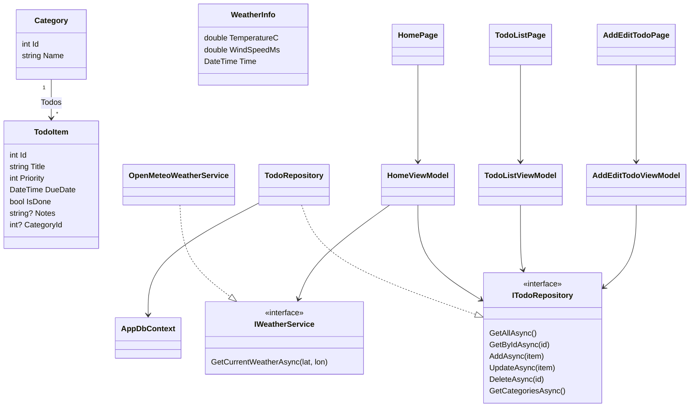

# LifeManagementApp

.NET MAUI app for managing everyday life. It combines to-do list with weather and tells when it is kitesurfing weather.

Course: Client-Side Programming (TT00BI73), VAMK, autumn 2026
Author: Elton Zekiqi

## Description

- **Home page** shows top 3 open to-dos (highest priority first, then earliest due date), current weather in Vaasa from Open-Meteo (temperature and wind in m/s) and big "🪁 Kitesurf weather!" notice when wind is over 5 m/s.
- **To-dos page** shows all to-dos in CollectionView. List can be sorted by priority or by due date. From here you can add new to-do or tap a row to edit it.
- **Add / edit page** is a form with title, priority 1–5, due date, category, notes and done. Empty title is not accepted. In edit mode there is also Delete button.
- Data is saved to SQLite database with EF Core Code First. To-do has category (Category 1–N TodoItem).
- If there is no network the app shows error message and does not crash. Loading spinner is shown while weather loads.

## How to run

Requirements: .NET 9 SDK and MAUI workload (`dotnet workload install maui`), Windows or Android.

```
git clone <repo-url>
cd LifeManagementApp
dotnet build LifeManagementApp/LifeManagementApp.csproj -t:Run -f net9.0-windows10.0.19041.0
```

Or open `LifeManagementApp.sln` in Visual Studio 2022, choose Windows Machine or Android emulator and press F5.

Note: database is created with `EnsureCreated()`. If you change model (for example add new field to TodoItem), old database does not get the new column. Then delete the app data (uninstall app, or delete `lifemanagement.db3` from app data folder) and start again.

## Project structure

```
LifeManagementApp/
├── Models/        TodoItem, Category, WeatherInfo, OpenMeteoResponse, OpenMeteoCurrent
├── ViewModels/    HomeViewModel, TodoListViewModel, AddEditTodoViewModel
├── Views/         HomePage, TodoListPage, AddEditTodoPage
├── Services/      ITodoRepository, TodoRepository, IWeatherService, OpenMeteoWeatherService,
│                  TodoSorter, KiteRules, TodoValidator, AppRoutes
├── Converters/    StringNotEmptyToBoolConverter, PriorityToColorConverter
├── Data/          AppDbContext
├── AppShell.xaml  (tabs + route for add/edit page)
└── MauiProgram.cs (DI registrations)
```

## Architecture

MVVM. Views have only XAML and small code-behind (constructor + OnAppearing). ViewModels use CommunityToolkit.Mvvm (`[ObservableProperty]`, `[RelayCommand]`) and do not know UI controls. Data access and HTTP are in services behind interfaces. Everything is wired with dependency injection in `MauiProgram.cs`.

DI lifetimes:
- **Singleton**: TodoRepository, HttpClient, OpenMeteoWeatherService. They have no own state so one instance is enough. One shared HttpClient so sockets are reused.
- **Transient**: ViewModels and pages. New instance every time, so for example add/edit form always starts clean.
- **DbContextFactory**: repository makes new short DbContext for every operation.

## Class diagram



## Extra features (bonus)

- Mark to-do done, edit and delete (on edit page)
- Categories (1–N relation)

## AI use

I used Claude (Anthropic) to generate the first version of the code and this README. After that I went through every file, ran the app and tested features myself, and asked Claude to explain parts I did not understand (for example DI lifetimes, DbContextFactory and compiled bindings). I made changes to the code myself to check that I understand how it works.
