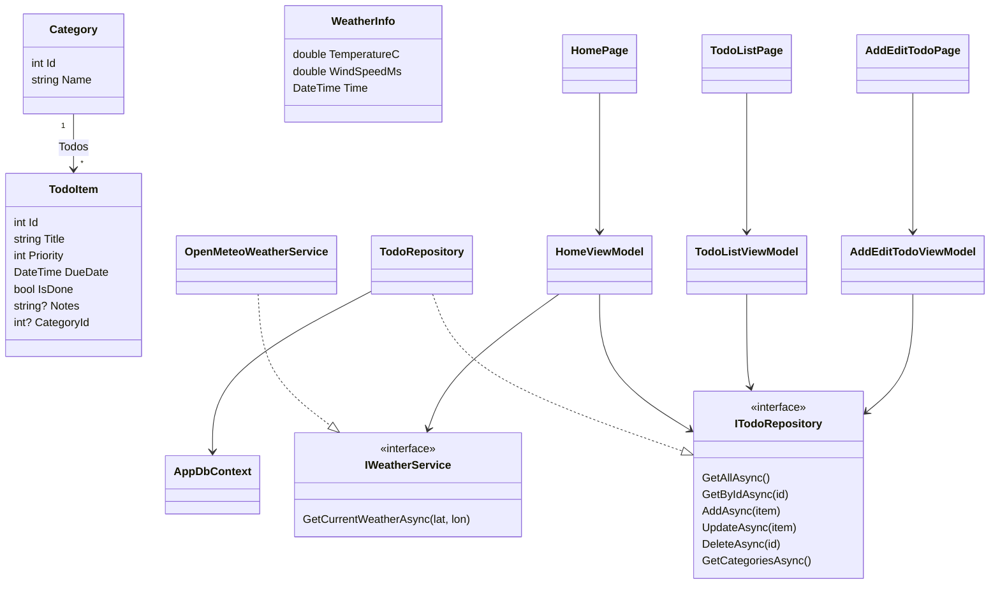

# LifeManagementApp

Client-Side Programming -kurssin projekti (TT00BI73, VAMK, syksy 2026).
Tekijä: Elton Zekiqi

Tein .NET MAUI -apin, missä on to-do-lista ja Vaasan sää samassa. Lisäks se näyttää, jos on hyvä keli leijasurffaukseen.

## Mitä tää tekee

**Etusivu**
- Näyttää 3 tärkeintä tekemätöntä tehtävää (isoin prioriteetti ekana, tasatilanteessa aikaisempi eräpäivä).
- Hakee Vaasan sään Open-Meteosta (lämpötila + tuuli m/s).
- Jos tuulee yli 5 m/s, tulee iso sininen "🪁 Leijasurffikeli!" -laatikko.

**Tehtävät**
- Kaikki tehtävät listassa.
- Voi järjestää prioriteetin tai eräpäivän mukaan.
- "+ Lisää tehtävä" -napista pääsee lisäämään uuden.
- Tehtävää painamalla pääsee muokkaamaan sitä.

**Lisää / muokkaa**
- Otsikko, prioriteetti 1–5, eräpäivä, kategoria, muistiinpanot ja tehty-ruksi.
- Tyhjällä otsikolla ei voi tallentaa (tulee punainen virhe).
- Muokatessa näkyy myös Poista-nappi.

**Muuta**
- Tehtävät tallentuu SQLite-kantaan (EF Core Code First), eli ne pysyy tallessa vaikka apin sulkee.
- Kategoriat (Koulu, Työ, Koti, Urheilu) on omassa taulussa (1–N-suhde).
- Jos ei oo nettiä, appi näyttää virheen eikä kaadu. Latauksen aikana pyörii latausympyrä.

## Miten saa käyntiin

Tarvii .NET 9 SDK:n ja MAUI-workloadin (`dotnet workload install maui`). Testattu Windowsilla.

```bash
git clone <repo-url>
cd LifeManagementApp
dotnet build LifeManagementApp/LifeManagementApp.csproj -f net9.0-windows10.0.19041.0
dotnet run --project LifeManagementApp/LifeManagementApp.csproj -f net9.0-windows10.0.19041.0
```

Tai sit avaa `LifeManagementApp.sln` Visual Studiossa, valitse Windows Machine ja paina F5.

`global.json` on siks, että projekti käyttää .NET 9:ää vaikka koneella ois uudempikin versio.

Huom: tietokanta tehdään `EnsureCreated()`:lla. Jos lisää uuden kentän esim. TodoItemiin, vanha kanta ei päivity itestään, vaan pitää poistaa `lifemanagement.db3` ja käynnistää uudestaan.

## Kansiot

```text
LifeManagementApp/
├── Models/        TodoItem, Category, WeatherInfo, OpenMeteoResponse, OpenMeteoCurrent
├── ViewModels/    HomeViewModel, TodoListViewModel, AddEditTodoViewModel
├── Views/         HomePage, TodoListPage, AddEditTodoPage
├── Services/      ITodoRepository, TodoRepository, IWeatherService, OpenMeteoWeatherService,
│                  TodoSorter, KiteRules, TodoValidator, AppRoutes
├── Converters/    StringNotEmptyToBoolConverter, PriorityToColorConverter
├── Data/          AppDbContext
├── AppShell.xaml  välilehdet + reitti lisää/muokkaa-sivulle
└── MauiProgram.cs DI-rekisteröinnit
```

## Miten se on tehty

MVVM-mallilla. Sivuilla on vaan XAML ja tosi vähän code-behindiä (konstruktori + OnAppearing). Logiikka on ViewModeleissa, ja niissä on käytetty CommunityToolkit.Mvvm:ää (`[ObservableProperty]`, `[RelayCommand]`). ViewModelit ei koske suoraan UI-kontrolleihin.

Tietokanta- ja sääjutut on serviceissä rajapintojen (`ITodoRepository`, `IWeatherService`) takana, ja kaikki kytketään yhteen `MauiProgram.cs`:ssä dependency injectionilla.

- **Singleton**: TodoRepository, HttpClient ja OpenMeteoWeatherService. Niillä ei oo omaa tilaa, niin yks riittää (ja HttpClientiä ei kannata tehdä aina uutta ettei socketit lopu).
- **Transient**: ViewModelit ja sivut. Tulee aina uus, eli esim. lomake on tyhjä kun sen avaa.
- **DbContext**: Repository tekee joka operaatioon oman lyhyen DbContextin.

## Luokkakaavio



## Tekoäly

Käytin Claudea apuna koodin ja tän readmen kirjottamisessa. Kävin koodit läpi, testasin apin ite ja kyselin selityksiä kohtiin mitä en heti tajunnu.
