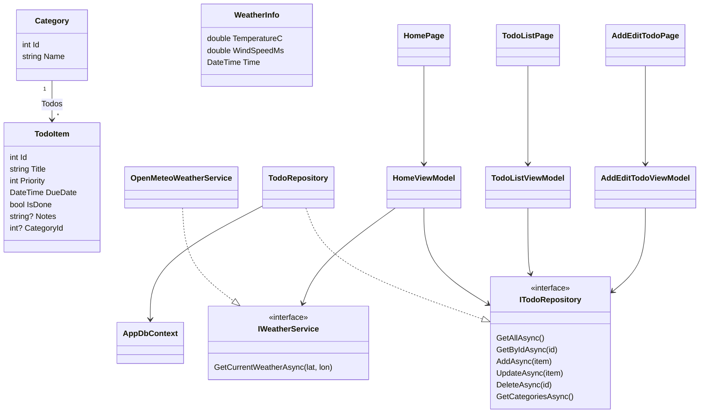

# LifeManagementApp

Mun projekti Client-Side Programming -kurssille (TT00BI73, VAMK, syksy 2026).  
Tekijä: Elton Zekiqi

Tein .NET MAUI -sovelluksen, jossa on to-do-lista ja Vaasan sää samassa paikassa. Lisäksi appi kertoo, jos tuuli riittää leijasurffaukseen.

## Mitä sovellus tekee

**Etusivu**
- Näyttää 3 tärkeintä tekemätöntä tehtävää. Ensin korkein prioriteetti, ja jos menee tasan, niin aikaisempi eräpäivä voittaa.
- Hakee Vaasan sään Open-Meteosta (lämpötila ja tuulen nopeus m/s).
- Jos tuulee yli 5 m/s, ruudulle tulee iso sininen "🪁 Leijasurffikeli!" -laatikko.

**Tehtävät**
- Listaa kaikki tehtävät.
- Tehtävät voi järjestää prioriteetin tai eräpäivän mukaan.
- "+ Lisää tehtävä" -napista avautuu uuden tehtävän näkymä.
- Tehtävää napauttamalla pääsee muokkaamaan sitä.

**Lisää / muokkaa**
- Kentät: otsikko, prioriteetti (1–5), eräpäivä, kategoria, muistiinpanot ja tehty-ruksi.
- Ilman otsikkoa ei voi tallentaa, vaan tulee punainen virheilmoitus.
- Muokatessa näkyy myös Poista-nappi.

**Muuta**
- Tehtävät tallentuvat SQLiteen (EF Core Code First), joten ne säilyvät sovelluksen sulkemisen jälkeen.
- Kategoriat (Koulu, Työ, Koti, Urheilu) ovat omassa taulussa (1–N-suhde: yhdellä kategorialla voi olla monta tehtävää).
- Jos verkkoyhteys puuttuu, säästä näytetään virheilmoitus eikä sovellus kaadu. Latauksen aikana näkyy latausympyrä.

## Käynnistäminen

Tarvitset .NET 9 SDK:n ja MAUI-workloadin (`dotnet workload install maui`). Olen testannut sovelluksen Windowsilla.

```bash
git clone <repo-url>
cd LifeManagementApp
dotnet build LifeManagementApp/LifeManagementApp.csproj -f net9.0-windows10.0.19041.0
dotnet run --project LifeManagementApp/LifeManagementApp.csproj -f net9.0-windows10.0.19041.0
```

Vaihtoehtoisesti voit avata `LifeManagementApp.sln` Visual Studiossa, valita Windows Machinen ja painaa F5.

Projektissa on `global.json`, jotta .NET 9 pysyy käytössä vaikka koneella olisi uudempiakin SDK-versioita.

> **Huom:** Tietokanta luodaan `EnsureCreated()`-metodilla. Jos muutat tietokantamalleja (esim. lisäät kentän `TodoItem`-luokkaan), vanha kanta ei päivity automaattisesti. Silloin pitää poistaa `lifemanagement.db3` ja käynnistää sovellus uudestaan.

## Projektin rakenne

```text
LifeManagementApp/
├── Models/        TodoItem, Category, WeatherInfo, OpenMeteoResponse, OpenMeteoCurrent
├── ViewModels/    HomeViewModel, TodoListViewModel, AddEditTodoViewModel
├── Views/         HomePage, TodoListPage, AddEditTodoPage
├── Services/      ITodoRepository, TodoRepository, IWeatherService, OpenMeteoWeatherService,
│                  TodoSorter, KiteRules, TodoValidator, AppRoutes
├── Converters/    StringNotEmptyToBoolConverter, PriorityToColorConverter
├── Data/          AppDbContext
├── AppShell.xaml  välilehdet ja reititys
└── MauiProgram.cs DI-rekisteröinnit
```

## Toteutus ja arkkitehtuuri

Sovellus noudattaa MVVM-mallia. Sivuilla (`Views`) on pääosin XAML:ia ja code-behindissa vain perusjutut (konstruktori ja `OnAppearing`). Sovelluslogiikka on ViewModeleissa, ja niissä on käytetty CommunityToolkit.Mvvm-kirjastoa (`[ObservableProperty]`, `[RelayCommand]`). ViewModelit eivät käsittele suoraan UI-kontrolleja.

Tietokanta- ja säälogiikka on erotettu omiin serviceihin rajapintojen (`ITodoRepository`, `IWeatherService`) taakse, ja kaikki kytketään yhteen `MauiProgram.cs`-tiedostossa dependency injectionilla.

- **Singleton**: `TodoRepository`, `HttpClient` ja `OpenMeteoWeatherService`. Näillä ei ole omaa tilaa, joten yksi instanssi riittää koko sovelluksen elinkaaren ajan (ja `HttpClient` kannattaa muutenkin pitää jaettuna, ettei socketit lopu).
- **Transient**: ViewModelit ja sivut. Näistä luodaan uusi instanssi joka kerta, jotta esimerkiksi lisäyslomake on aina tyhjä kun sen avaa.
- **DbContext**: Repository luo jokaista tietokantaoperaatiota varten oman lyhytikäisen `DbContext`-instanssin.

## Luokkakaavio



## Tekoälyn käyttö

Hyödynsin tekoälyä (Claudea) apuna koodin kirjoittamisessa ja README:n luonnostelussa. Kävin koodin läpi, kyselin selityksiä niistä kohdista jotka kaipasivat tarkennusta, testasin sovelluksen toiminnan itse ja muokkasin kokonaisuuden omaan tyyliini.
