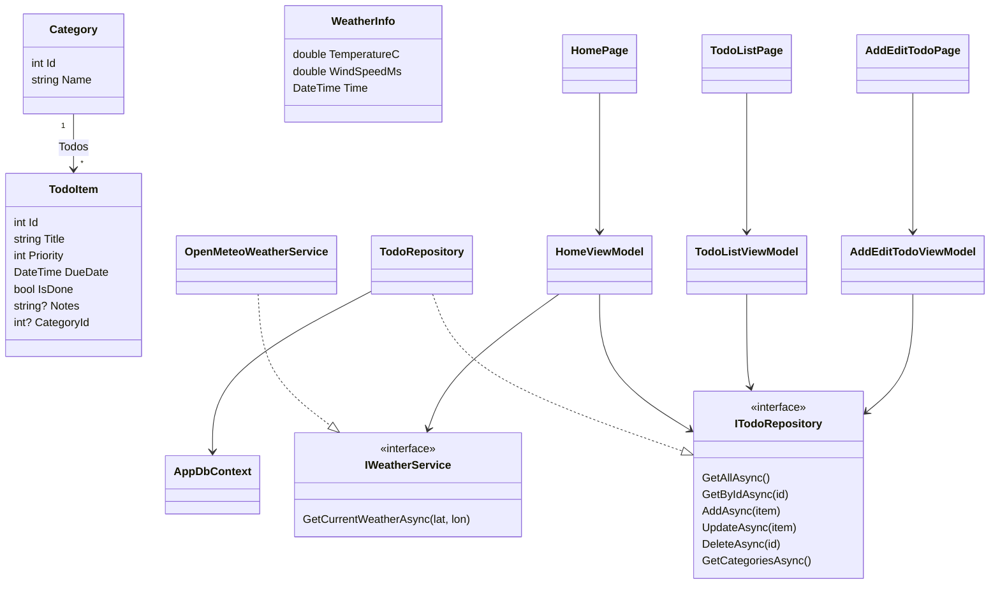

# LifeManagementApp

Mun projekti Client-Side Programming -kurssille (TT00BI73, VAMK, syksy 2026).
Tekijä: Elton Zekiqi

Eli tää on .NET MAUI -appi, jossa on to-do-lista ja sää samassa paikassa. Lisäks se kertoo, jos on leijasurffikeli.

## Mitä appi tekee

**Etusivu**
- Näyttää 3 tärkeintä tehtävää, jotka ei oo vielä tehty. Ensin isoin prioriteetti, ja jos on tasan, nii se jonka eräpäivä on aikasemmin.
- Näyttää Vaasan sään Open-Meteosta (lämpötila + tuuli m/s).
- Jos tuulee yli 5 m/s, tulee iso sininen "🪁 Leijasurffikeli!" -laatikko.

**Tehtävät**
- Kaikki tehtävät listassa.
- Voi järjestää prioriteetin tai eräpäivän mukaan.
- "+ Lisää tehtävä" -napista pääsee lisäämään uuden.
- Kun napauttaa tehtävää, pääsee muokkaamaan sitä.

**Lisää / muokkaa**
- Otsikko, prioriteetti 1–5, eräpäivä, kategoria, muistiinpanot ja tehty-ruksi.
- Tyhjällä otsikolla ei voi tallentaa, tulee punanen virhe.
- Muokatessa näkyy myös Poista-nappi.

**Muuta**
- Tehtävät menee SQLite-tietokantaan (EF Core Code First), eli ne ei katoo kun appin sulkee.
- Tehtävällä voi olla kategoria (Koulu, Työ, Koti, Urheilu). Eli yhellä kategorialla voi olla monta tehtävää.
- Jos ei oo nettiä, appi näyttää virheen eikä kaadu. Kun sää latautuu, pyörii latausympyrä.

## Miten saa käyntiin

Tarvii .NET 9 SDK:n ja MAUI-workloadin (`dotnet workload install maui`). Mä oon testannu Windowsilla.

```
git clone <repo-url>
cd LifeManagementApp
dotnet build LifeManagementApp/LifeManagementApp.csproj -f net9.0-windows10.0.19041.0
dotnet run --project LifeManagementApp/LifeManagementApp.csproj -f net9.0-windows10.0.19041.0
```

Tai sit avaa `LifeManagementApp.sln` Visual Studiossa, valitse Windows Machine ja paina F5.

`global.json` on siks, että projekti käyttää .NET 9:ää vaikka koneella ois uudempikin.

Huom: tietokanta tehään `EnsureCreated()`:lla. Jos lisää uuden kentän esim. TodoItemiin, vanha kanta ei päivity. Silloin pitää poistaa `lifemanagement.db3` ja käynnistää uudestaan.

## Kansiot

```
LifeManagementApp/
├── Models/        TodoItem, Category, WeatherInfo, OpenMeteoResponse, OpenMeteoCurrent
├── ViewModels/    HomeViewModel, TodoListViewModel, AddEditTodoViewModel
├── Views/         HomePage, TodoListPage, AddEditTodoPage
├── Services/      ITodoRepository, TodoRepository, IWeatherService, OpenMeteoWeatherService,
│                  TodoSorter, KiteRules, TodoValidator, AppRoutes
├── Converters/    StringNotEmptyToBoolConverter, PriorityToColorConverter
├── Data/          AppDbContext
├── AppShell.xaml  välilehdet + reitti lisää/muokkaa-sivulle
└── MauiProgram.cs DI-rekisteröinnit
```

## Miten se on rakennettu

MVVM. Sivuilla on vaan XAML ja tosi vähän code-behindiä (konstruktori + OnAppearing). Kaikki logiikka on ViewModeleissa, ja niissä käytetään CommunityToolkit.Mvvm:ää (`[ObservableProperty]`, `[RelayCommand]`). ViewModelit ei koske suoraan mihinkään UI-kontrolleihin.

Tietokantajutut ja sään haku on serviceissä, ja niillä on rajapinnat (`ITodoRepository`, `IWeatherService`). Kaikki kytketään yhteen `MauiProgram.cs`:ssä dependency injectionilla.

Miks Singleton vai Transient:
- **Singleton**: TodoRepository, HttpClient, OpenMeteoWeatherService. Niillä ei oo omaa tilaa, joten yks riittää koko appiin. HttpClientiä ei kannata tehä aina uutta, koska socketit voi loppua.
- **Transient**: ViewModelit ja sivut. Joka kerta tulee uus, joten esim. lomake on aina tyhjä kun sen avaa.
- **DbContextFactory**: repository tekee joka operaatioon oman lyhyen DbContextin.

## Luokkakaavio



## Lisäjutut (bonus)

- Tehtävän voi merkata tehdyks, muokata ja poistaa (muokkaussivulla)
- Kategoriat (1–N-relaatio)

## Tekoäly

Käytin Claudea apuna koodin  ja tän readme kirjottamiseen. Sen jälkeen kävin koodin läpi, testasin appia itse ja kyselin Claudelta selityksiä kohtiin joita en tajunnu
